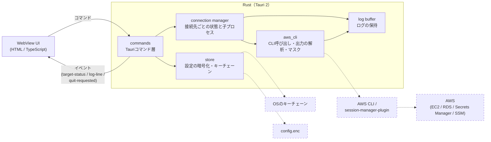

# 6. アーキテクチャ

[目次に戻る](README.md)

Tauri 2で、画面はWebView（HTML/TypeScript）、処理はRustで書く。AWSとのやり取りはすべてAWS CLIを子プロセスとして呼び、Rust側の接続管理が接続ごとの状態と子プロセスを持つ。

## 構成図（5モジュールと外部要素）

画面はコマンドで処理を頼み、状態の変化とログの行はイベントで受け取る。点線の要素はアプリの外にある。

## 6.1 コマンドとイベント

| 種類 | 名前 | 内容 |
| --- | --- | --- |
| コマンド | `list_targets` / `save_target` / `delete_target` | 接続先の一覧・保存・削除 |
| コマンド | `move_target(id, direction)` | 一覧で1つ上・下へ移動し、移動後の一覧を返す（direction は up / down） |
| コマンド | `duplicate_target(sourceId, input)` | 複製元のすぐ下に新しい接続先を追加する（重複判定・入力チェックは `save_target` と同じ） |
| コマンド | `list_profiles` | `~/.aws/config` のプロファイル一覧 |
| コマンド | `list_runtimes` | 接続先ごとの現在の状態 |
| コマンド | `connect(id)` / `disconnect(id)` | 接続の開始・停止 |
| コマンド | `reveal_password(id)` / `copy_password(id)` | 表示またはコピーするときだけパスワードを画面に渡す |
| コマンド | `copy_text(text)` | Host・Port・接続コマンドなどをクリップボードへコピー |
| コマンド | `get_logs(id)` / `clear_logs(id)` / `save_logs(id, path)` | ログの取得・クリア・ファイルへの保存 |
| コマンド | `import_preview(path)` / `import_apply` / `export_targets(path)` | インポートとエクスポート |
| コマンド | `check_prerequisites` | AWS CLIとPluginの有無とバージョン |
| コマンド | `set_tool_paths` | aws / session-manager-plugin のパスを指定する |
| コマンド | `get_settings` / `set_last_selected(id)` | アプリ設定の取得、最後に選んだ接続先の保存 |
| コマンド | `get_config_info` / `open_config_dir` | 設定ファイルの暗号化状態と保存場所、保存先フォルダを開く |
| コマンド | `quit_app` | 接続中のセッションをすべて終了してアプリを閉じる |
| イベント | `target-status` | 接続先ID、状態、メッセージ |
| イベント | `log-line` | 接続先ID、時刻、出どころ（app / ssm）、stdout / stderr、本文 |
| イベント | `quit-requested` | 接続中の件数。画面で確認後に `quit_app` を呼ぶ |

## 6.2 接続の状態

状態は「未接続 → ログイン待ち → 準備中（検索・シークレット取得） → 接続中」と進み、停止で未接続に戻る。どの段階でも失敗すれば「エラー」になり、再接続ボタンで最初からやり直す。

## 6.3 子プロセスの扱い

- `tokio::process` で起動し、stdoutとstderrを1行ずつ非同期に読んでログに流す。シェルを経由せず、引数は配列で渡す。
- `start-session` の `--parameters` はJSONではなく `host=…,portNumber=3306,localPortNumber=…` の形式で渡す（Windowsでの引用符の崩れを避けるため。既存のPowerShell版と同じ）。
- Windows: 子プロセスをJob Objectに入れ、アプリが落ちても session-manager-plugin まで終了させる。コンソール窓が出ないよう `CREATE_NO_WINDOW` を付ける。
- Mac: 子プロセスを専用のプロセスグループで起動し、停止時はグループにSIGTERM、3秒後に残っていればSIGKILLを送る。
- Macでは、Finderから起動したアプリはシェルのPATHを引き継がない。`/usr/local/bin`、`/opt/homebrew/bin` も探し、見つからなければ設定画面でパスを指定できるようにする。
- ポートの空き確認は `127.0.0.1:<port>` へのbindを試して判定する。

## 6.4 主なクレート

`tauri`、`tokio`、`serde` / `serde_json`、`aes-gcm`、`rand`、`zeroize`、`keyring`、`uuid`、`thiserror`、Tauriプラグイン（`dialog`、`clipboard-manager`、`updater`）、Windowsは `windows-sys`、Macは `nix`。
